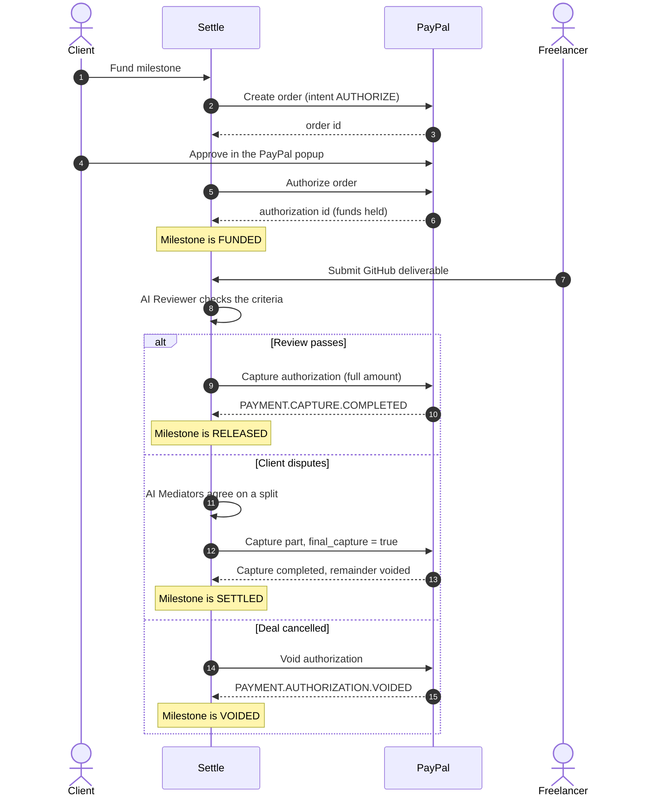

# Settle

**AI escrow for freelancers.** The client's payment is held by PayPal, an AI agent checks the delivered work against the agreed acceptance criteria, and the money is released, split or returned based on the result.

Built for the PayPal AI Hackathon. Sandbox only.

## The problem

Freelancers and clients do not trust each other at the moment money changes hands.

- Freelancers do the work first and then chase the invoice. Late and missing payments are common.
- Clients who pay up front have no recourse when the work is late, incomplete or not what was agreed.
- Traditional escrow needs a human to decide whether the work is done. That is slow and expensive, so it is not used for small jobs.

## How it works

1. **Scope.** A Scoper agent turns a job brief into milestones. Each milestone has acceptance criteria and a price.
2. **Fund.** The client funds a milestone with PayPal. The order uses `intent: AUTHORIZE`, so the money is held on the client's account and not yet paid.
3. **Deliver.** The freelancer submits a GitHub repository as the deliverable.
4. **Review.** A Reviewer agent reads the repository and checks every criterion, with evidence, a verdict and a score.
5. **Settle.**
   - Pass: Settle captures the authorization and the freelancer is paid in full.
   - Dispute: two Mediator agents, one for each side, negotiate a split. Settle captures that share with `final_capture: true`, and PayPal voids the rest back to the client.
   - Cancel: Settle voids the authorization and the hold is released.

### Status

| Part | State |
| --- | --- |
| PayPal Sandbox loop: authorize, capture, void | Working, verified end to end in the sandbox |
| PayPal webhooks (signature-verified, idempotent) | Working, verified with genuine sandbox deliveries |
| Scoper, Reviewer and Mediator agents (Gemini) | Working |
| Landing page, dashboard (AG Grid), deal, AI review and mediation pages | Working |
| Partial settlement capture after mediation | Implemented, off by default (`SETTLEMENT_CAPTURE_ENABLED`) until verified in the sandbox |

## PayPal flow



## Stack

- Next.js (App Router), TypeScript, Tailwind CSS, shadcn/ui
- Prisma 6 and Neon Postgres
- `@paypal/paypal-server-sdk` on the server, `@paypal/react-paypal-js` for the PayPal button
- Vercel AI SDK (`ai`, `@ai-sdk/google`) with Gemini Flash, structured output with zod schemas
- `@octokit/rest` to read GitHub repositories
- Render for hosting

## Local setup

Requirements: Node.js 20 or newer, a free [Neon](https://neon.tech) database and a [PayPal developer](https://developer.paypal.com) account.

```powershell
git clone <this repo>
cd settle
npm install
Copy-Item .env.example .env      # then fill in the values below
npx prisma migrate dev           # creates the tables
npm run db:seed                  # creates the demo deal
npm run dev
```

Open <http://localhost:3000> and click **Create a deal**, or go straight to <http://localhost:3000/deals/demo>.

Useful scripts:

| Command | What it does |
| --- | --- |
| `npm run dev` | Start the dev server |
| `npm run build` / `npm start` | Production build and server |
| `npm run typecheck` | TypeScript check |
| `npm run lint` | ESLint |
| `npm run db:seed` | Reset the read-only demo deal (`/deals/demo`, three milestones) |

## Environment variables

| Variable | Required | Where to get it |
| --- | --- | --- |
| `DATABASE_URL` | Yes | Neon dashboard, connection string with `?sslmode=require` |
| `PAYPAL_CLIENT_ID` | Yes | PayPal Developer Dashboard, Apps & Credentials, **Sandbox** app |
| `PAYPAL_CLIENT_SECRET` | Yes | Same sandbox app |
| `PAYPAL_BASE_URL` | No | `https://api-m.sandbox.paypal.com` (the only accepted value: Settle is sandbox-only) |
| `PAYPAL_WEBHOOK_ID` | For webhooks | The webhook registered on **the same** sandbox app (each URL has its own ID) |
| `SETTLEMENT_CAPTURE_ENABLED` | No | `false` by default. Only `true` lets an accepted mediation capture a partial amount |
| `GOOGLE_GENERATIVE_AI_API_KEY` | For the AI agents | [Google AI Studio](https://aistudio.google.com/apikey) |
| `GEMINI_MODEL` | No | Defaults to `gemini-2.5-flash` |
| `GITHUB_TOKEN` | No | Raises the GitHub API rate limit |

Secrets are read from the environment only. `.env` is git-ignored.

### Webhook

In the sandbox app, add a webhook that points to `https://<your-host>/api/webhooks/paypal` and subscribe to:

- `Payment authorization created`
- `Payment authorization voided`
- `Payment capture completed`
- `Payment capture denied`
- `Payment capture pending`

Copy the webhook ID into `PAYPAL_WEBHOOK_ID`. Every delivery is verified with PayPal's `verify-webhook-signature` API before it is trusted, processed once per PayPal event id, cross-checked against the milestone's order, authorization and capture ids, and written to the audit log. Webhooks confirm and reconcile; they never start a payment or mark a milestone released. For local testing, expose port 3000 with `ngrok http 3000`.

Note: PayPal does not support India-to-India payments. Use a **US** sandbox Business account as the app owner (payee) and a **US** sandbox Personal account as the buyer.

## Testing in the sandbox (for judges)

You need a sandbox **personal** (buyer) account. Create one under *Testing Tools > Sandbox Accounts* in the PayPal Developer Dashboard, or use the default one that comes with every developer account. No real money moves.

The read-only demo deal at `/deals/demo` (tagged **DEMO**) shows every stage without PayPal. To move real sandbox money:

1. Go to **New deal**, click **Use example**, then **Generate milestones with AI**, then **Save and generate link** and **Open deal**.
2. With **Client** selected in the top bar, click **Fund milestone**, then the PayPal button, and log in with the sandbox **Personal** account. The milestone becomes **Funded**: the amount is authorized and held, not captured.
3. Switch to **Freelancer**, paste a public GitHub repository and **Submit for review**. Gemini checks every acceptance criterion and cites files as evidence.
4. Switch to **Client**: **Read AI review**, then **Approve & release**. The authorization is captured and paid to the sandbox Business account.
5. Or fund another milestone and **Void hold**: the authorization is voided and nothing is charged.
6. Or **Dispute** a reviewed milestone: two AI advocates negotiate a split on the **Mediation** page, and both roles accept it.

To reset the demo deal, run `npm run db:seed`.

`GET /api/health` returns `{ "ok": true, "db": "up" }` when the app can reach the database.

## API

| Route | Purpose |
| --- | --- |
| `POST /api/paypal/orders` | Body `{ milestoneId }`. Creates an AUTHORIZE order and saves the order id |
| `POST /api/paypal/orders/[orderId]/authorize` | Authorizes the approved order, saves the authorization id, sets `FUNDED` |
| `POST /api/milestones/[id]/approve` | Client approval: full capture, sets `RELEASED` |
| `POST /api/milestones/[id]/void` | Voids the authorization, sets `VOIDED` |
| `POST /api/milestones/[id]/settlement/accept` | Body `{ role }`. Records acceptance; when both accepted (and enabled) captures the agreed share |
| `POST /api/webhooks/paypal` | Verifies the signature, deduplicates, reconciles and logs the event |
| `POST /api/ai/scope` | Gemini Scoper: brief to milestones, criteria and prices |
| `POST /api/deals`, `GET /api/deals/[id]` | Create and read a deal |
| `POST /api/milestones/[id]/submit` | Freelancer submits a GitHub repo; the AI review runs in the same request |
| `POST /api/ai/review/[milestoneId]` | Gemini Reviewer (cached per deliverable) |
| `POST /api/milestones/[id]/dispute` | Client opens a dispute; funds stay authorized |
| `POST /api/ai/mediate/[milestoneId]` | Two AI advocates negotiate and propose a split |
| `GET /api/health` | Liveness and database ping |

Payment rules: the amount of every order is read from the database, never the browser. Full capture happens only on client approval, partial capture only after both parties accept a settlement. AI code never imports the PayPal module. Every capture claims the milestone first and sends a stable `PayPal-Request-Id`, so a retry or double click cannot capture twice.

## Deploying

**Vercel:** import the repository, set the environment variables above and use the build command `prisma migrate deploy && next build`. Register a webhook for the deployed URL on the same PayPal sandbox app and use its ID.

**Render:** `render.yaml` describes one web service. Create a new Blueprint from the repository, then set the secret environment variables in the Render dashboard. The build runs `prisma migrate deploy`, so the database schema is created on the first deploy.

## Tools used

- **Gemini** (Google AI Studio) as the model behind the Scoper, Reviewer and Mediator agents
- **APIMatic Context Plugin** for accurate PayPal SDK context while coding
- **PayPal AI Toolkit** for PayPal integration best practices
- **AG Studio** for the dashboard
- **Render** for hosting

## License

[MIT](./LICENSE) (c) Mithul
