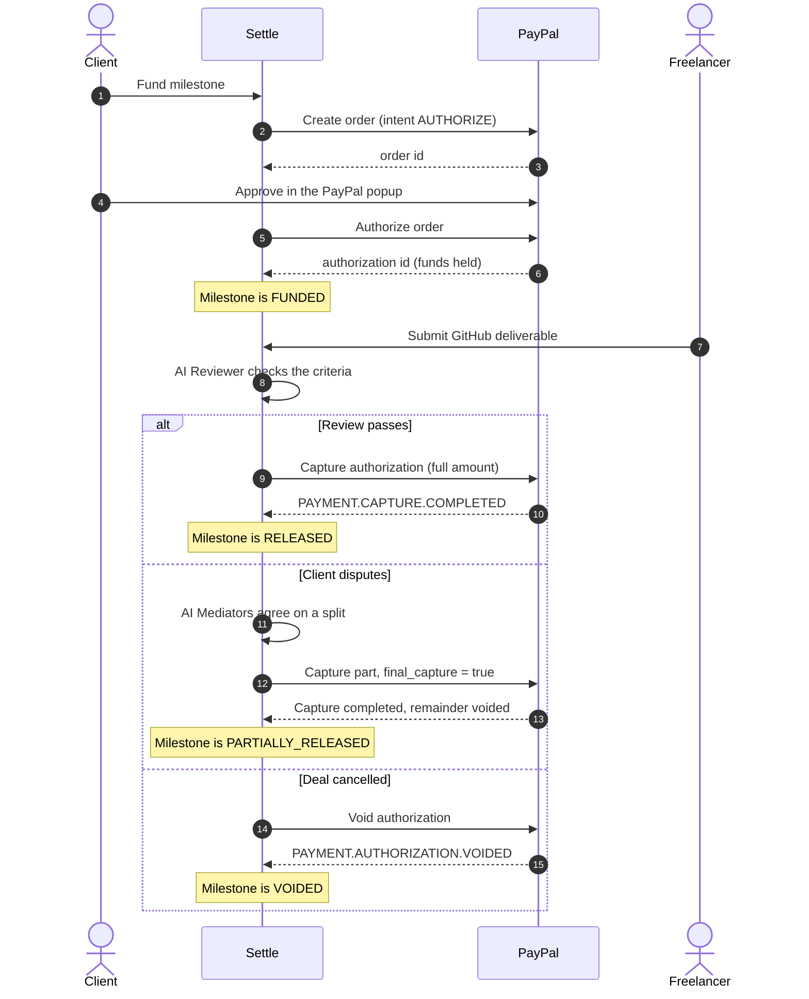

# Settle

**AI escrow for freelancers.** The client's payment is held by PayPal, an AI agent checks the delivered work against the agreed acceptance criteria, and the money is released, split or returned based on the result.

Built for the PayPal AI Hackathon. Sandbox only.

## The problem

Freelancers and clients do not trust each other at the moment money changes hands.

- Freelancers do the work first and then chase the invoice. Late and missing payments are common.
- Clients who pay up front have no recourse when the work is late, incomplete or not what was agreed.
- Traditional escrow needs a human to decide whether the work is done. That is slow and expensive, so it is not used for small jobs.

## How it works

1. **Scope.** A Scoper agent turns a job brief into milestones. Each milestone has acceptance criteria and a price.
2. **Fund.** The client funds a milestone with PayPal. The order uses `intent: AUTHORIZE`, so the money is held on the client's account and not yet paid.
3. **Deliver.** The freelancer submits a GitHub repository as the deliverable.
4. **Review.** A Reviewer agent reads the repository and checks every criterion, with evidence, a verdict and a score.
5. **Settle.**
   - Pass: Settle captures the authorization and the freelancer is paid in full.
   - Dispute: two Mediator agents, one for each side, negotiate a split. Settle captures that share with `final_capture: true`, and PayPal voids the rest back to the client.
   - Cancel: Settle voids the authorization and the hold is released.

### Status

| Part | State |
| --- | --- |
| PayPal payment loop: authorize, capture, void, webhooks | Working |
| Deal page with client and freelancer views | Working |
| Scoper, Reviewer and Mediator agents | Schemas defined, routes return `501` for now |
| AG Studio dashboard | Planned |

## PayPal flow



## Stack

- Next.js (App Router), TypeScript, Tailwind CSS, shadcn/ui
- Prisma 6 and Neon Postgres
- `@paypal/paypal-server-sdk` on the server, `@paypal/react-paypal-js` for the PayPal button
- Vercel AI SDK (`ai`, `@ai-sdk/google`) with Gemini Flash, structured output with zod schemas
- `@octokit/rest` to read GitHub repositories
- Render for hosting

## Local setup

Requirements: Node.js 20 or newer, a free [Neon](https://neon.tech) database and a [PayPal developer](https://developer.paypal.com) account.

```powershell
git clone <this repo>
cd settle
npm install
Copy-Item .env.example .env      # then fill in the values below
npx prisma migrate dev           # creates the tables
npm run db:seed                  # creates the demo deal
npm run dev
```

Open <http://localhost:3000> and click **Create a deal**, or go straight to <http://localhost:3000/deals/demo>.

Useful scripts:

| Command | What it does |
| --- | --- |
| `npm run dev` | Start the dev server |
| `npm run build` / `npm start` | Production build and server |
| `npm run typecheck` | TypeScript check |
| `npm run lint` | ESLint |
| `npm run db:seed` | Reset the demo deal (two milestones: $50 and $120) |

## Environment variables

| Variable | Required | Where to get it |
| --- | --- | --- |
| `DATABASE_URL` | Yes | Neon dashboard, connection string with `?sslmode=require` |
| `PAYPAL_CLIENT_ID` | Yes | PayPal Developer Dashboard, Apps & Credentials, **Sandbox** app |
| `PAYPAL_CLIENT_SECRET` | Yes | Same sandbox app |
| `PAYPAL_WEBHOOK_ID` | For webhooks | Same sandbox app, after adding a webhook (see below) |
| `GOOGLE_GENERATIVE_AI_API_KEY` | For the AI agents | [Google AI Studio](https://aistudio.google.com/apikey) |
| `GEMINI_MODEL` | No | Defaults to `gemini-2.5-flash` |
| `GITHUB_TOKEN` | No | Raises the GitHub API rate limit |

Secrets are read from the environment only. `.env` is git-ignored.

### Webhook

In the sandbox app, add a webhook that points to `https://<your-host>/api/webhooks/paypal` and subscribe to:

- `Payment capture completed`
- `Payment authorization voided`

Copy the webhook ID into `PAYPAL_WEBHOOK_ID`. Every webhook is verified with PayPal's `verify-webhook-signature` API before it is trusted. Webhooks need a public URL, so they work on Render but not on plain `localhost`. The payment loop does not depend on them: the app updates the milestone from the API response.

## Testing in the sandbox (for judges)

You need a sandbox **personal** (buyer) account. Create one under *Testing Tools > Sandbox Accounts* in the PayPal Developer Dashboard, or use the default one that comes with every developer account. No real money moves.

1. Open the demo deal at `/deals/demo`. Keep **View as: Client** selected.
2. On milestone 1 ($50), click the **PayPal** button and log in with the sandbox personal account. Approve the payment.
3. The badge changes to **Funded (held)**. In the sandbox buyer account the $50 appears as a pending authorization, not a completed payment.
4. Click **Release $50.00**. The badge changes to **Released** and the payment is captured to the sandbox business account.
5. Fund milestone 2 ($120) the same way, then click **Void hold**. The badge changes to **Voided** and the authorization disappears from the buyer account.
6. Switch to **View as: Freelancer** to see the same milestones from the other side.

To start over, run `npm run db:seed`.

`GET /api/health` returns `{ "ok": true, "db": "up" }` when the app can reach the database.

## API

| Route | Purpose |
| --- | --- |
| `POST /api/paypal/orders` | Body `{ milestoneId }`. Creates an AUTHORIZE order and saves the order id |
| `POST /api/paypal/orders/[orderId]/authorize` | Authorizes the approved order, saves the authorization id, sets `FUNDED` |
| `POST /api/milestones/[id]/release` | Full capture, sets `RELEASED` |
| `POST /api/milestones/[id]/void` | Voids the authorization, sets `VOIDED` |
| `POST /api/webhooks/paypal` | Verifies the signature, logs the event, updates the milestone |
| `GET /api/health` | Liveness and database ping |
| `POST /api/ai/scope`, `/api/milestones/[id]/review`, `/api/milestones/[id]/mediate` | AI agents, not implemented yet (`501`) |

The amount of every order is read from the database on the server. The browser only sends a milestone id.

## Deploying to Render

`render.yaml` describes one web service. Create a new Blueprint from the repository, then set the secret environment variables in the Render dashboard. The build runs `prisma migrate deploy`, so the database schema is created on the first deploy.

## Tools used

- **Gemini** (Google AI Studio) as the model behind the Scoper, Reviewer and Mediator agents
- **APIMatic Context Plugin** for accurate PayPal SDK context while coding
- **PayPal AI Toolkit** for PayPal integration best practices
- **AG Studio** for the dashboard
- **Render** for hosting

## License

[MIT](./LICENSE) © Mithul
